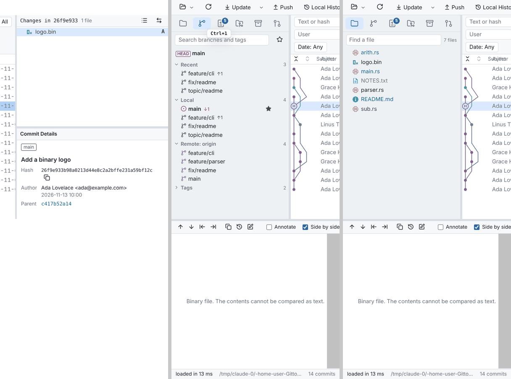
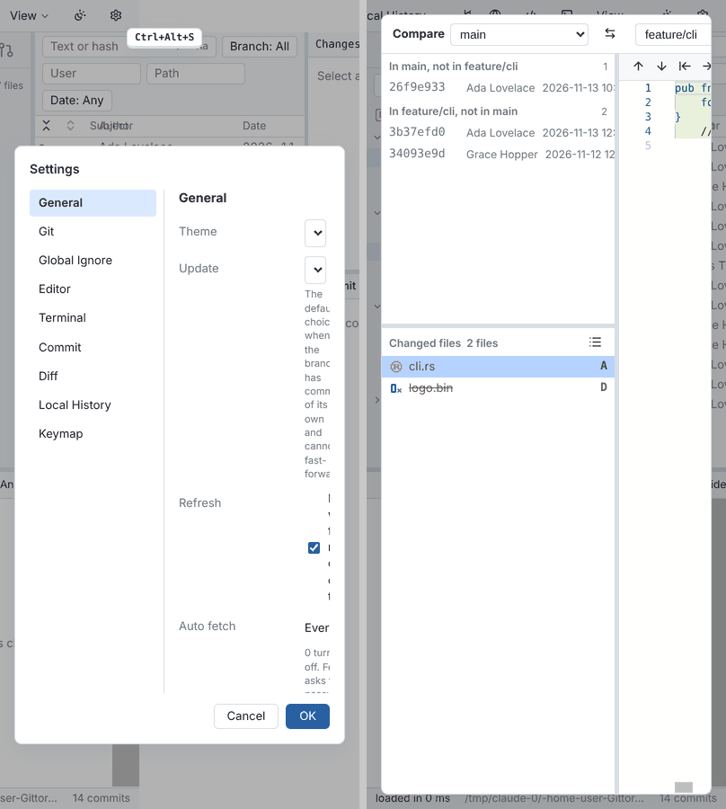
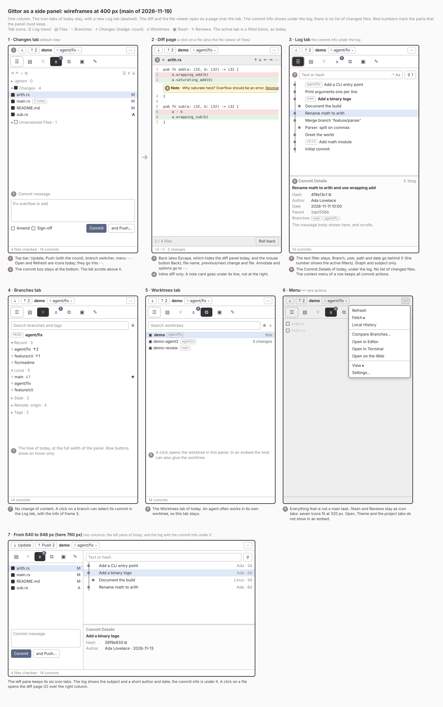
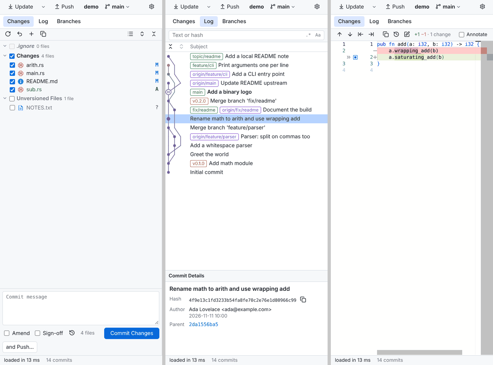

# A narrow layout for Gittor

The research examined `main` at commit `c1e3f99` (after v0.1.10).

## Status

The first implementation is on the branch `claude/narrow-layout`. See "Layout modes" in `AGENTS.md`.

- Done: the three modes and their breakpoints; the Log tab with the Commit Details under the log; no
  changed files and no Files tab in the small modes; the diff page with Back in one column; the toolbar
  with a second row; the filter bar with one button for the other filters; the Settings dialog in one
  column; the fix of View › Left Panel (the log no longer gets 0 px, and the setting stays after a reload).
- Not done yet: note cards under their lines; Compare, History and Review windows one pane at a time; a
  count of the active filters on the filter button; the embed mode (`?embed=1`, keys, theme); a token and
  an Origin check in the dev server.

The owner wants to put Gittor into another app as a side panel, for example Orca (an editor for
coding agents). The panel is narrow: 320, 400 or 480 px wide, about 900 px high. The report answers
two questions:

1. Which parts must a narrow view keep, and which parts can it fold, hide or move to a menu?
2. What else does an embed need: loading, keyboard keys, theme, security?

## Method

- The UI and the dev server were built from `main`. The demo repository came from
  `ui/e2e/make-demo-repo.sh`, with the local changes of `changelists.prep.sh`.
- A Playwright script opened the app at 320, 400, 480 and 1600 px wide and 900 px high. It took
  screenshots of the log, the left tabs (Branches, Worktrees, Files, Changes), a local diff, a commit,
  the filter bar, the View menu, the Settings dialog, the branch menu and the Compare window. It
  measured the `scrollWidth` of each region and listed the controls outside the viewport.
- A second script made a prototype with injected CSS only (no change in the repository): one column,
  the Changes tab, the Log tab with the Commit Details under it, and the diff over the whole panel.

## What changed since the first version of this report

- The left tabs are icons with tooltips (`lpTab` in `shell.ts`): Files, Branches, Changes, Worktrees,
  Stash, Reviews. The count is a badge on the icon. The active tab is a filled block.
- Worktrees have their own tab. Files is a new tab; it opens a file in the center panel
  (`centerTabs`, `fileHost`).
- Open and Refresh in the toolbar are icons. The toolbar now needs 748 px (825 px before).
- New themes: Plasma and Ember (glass).
- New default keys: `Mod+1` Branches, `Mod+2`/`Mod+K` Changes, `Mod+3` Worktrees, `Mod+4` Stash,
  `Mod+5` Reviews, `Mod+6` Submodules, `` Mod+` `` Files, `Alt+<n>` project tabs, `` Alt+` `` switch
  project, `Mod+B` new branch, `Mod+E` editor, `Escape` hides the diff panel, `Mod+W` closes the open
  file first.

## Result: the layout still has a fixed minimum width of 948 px

`applyLayout` in `shell.ts` sets the columns of `.top` to
`sidebarWidth (280) + 4 + minmax(300px, 1fr) + 4 + rightWidth (360)`. The sum is 948 px. Below
948 px, the document scrolls horizontally (`scrollWidth` 948 at 320, 400 and 480 px). The browser
scrolls the page to the focused element, so each view shows a different slice:

*Today at 400 px. Left: after the start, the view shows the right column only. Middle: the
Branches tab. Right: the Files tab. The log is cut on all three; the diff shows side by side.*

### What breaks, part by part

| Part | 320 px | 400 px | 480 px |
| --- | --- | --- | --- |
| Toolbar | Needs 748 px; less than half shows. | About half shows: Open, Refresh, Update, Push, part of Local History. | Settings, Theme, View, Terminal and IDE stay out of view. |
| Project tabs | Scroll without a scroll bar. They work, but show 1 or 2 tabs. | Same. | Same. |
| Left icon tabs (6) | No icon is cut. The six icons take about 270 px. The column is often out of view. | Same. | Same. |
| Branches, Worktrees, Files, Changes, Stash, Reviews panels | Each fits in its 280 px column. | Same. | Same. |
| Log columns | The center column is 300 px. The subject column has width 0; the header "Subject" overlaps "Author". | Same. | Same. |
| Filter bar | Wraps to 3 rows; branch, path and date are out of view. | Same. | Same. |
| Commit Details and changed files (right column, 360 px) | Wider than the viewport; long hashes are cut. | Fits only when the page scrolls to it. | Same. |
| Diff panel | Full width, but side by side gives about 15 characters per side. | About 25 per side. | About 35 per side. |
| Status bar | Fits; the path is cut. | Same. | Same. |
| Menus | Fit. A long branch menu is cut at the right at 320 px. | Fit. | Fit. |
| Settings dialog | 288 px wide. The section list takes about 140 px; the fields get one word per line. | A bit better. | Readable but tight. |
| Compare window (and History, Review) | 288 px: commits, files and diff side by side; the diff is about 60 px. | About 100 px. | About 180 px. |

*Today at 400 px: the Settings dialog (left) and the Compare window (right).*

No console error came during the run.

## Tasks in a side panel

A side panel next to a coding agent has these main tasks, in order of frequency:

1. See the local changes of the agent: the Changes tab.
2. Read a diff of a local change: the diff panel, inline, next/previous change and file.
3. Commit, and Commit and Push: the commit box.
4. Write and read review notes on local changes: the note layer, Copy All.
5. Switch the branch or the worktree: the branch switcher, the Worktrees tab.
6. Look at the recent history and the info of one commit: the graph, the subject, Commit Details.
7. Update and Push: two toolbar buttons.
8. Undo: the toast (it already fits).

Rare in a side panel: the changed files of an old commit, Compare Branches, Local History, Stash,
Reviews of branches, interactive rebase, Settings, remotes, open a repository.

## Recommendation, part by part

| Part | Recommendation | Reason |
| --- | --- | --- |
| Changes tab | Keep. Default view. | Tasks 1 and 3. |
| Diff of a local change | Keep, as a page over the whole panel, with a Back button. Force inline mode. | Task 2. |
| Review notes | Keep. Note cards under their lines (view zones). | Task 4. |
| Branch switcher, Update, Push | Keep in the top bar. | Tasks 5 and 7. |
| Left icon tabs | Keep Branches, Changes, Worktrees, Stash and Reviews, and add a Log tab. Six icons fit at 320 px. | The icons of today already fit. The keys `Mod+1`…`Mod+5` stay. |
| Files tab and its file viewer | Hide under the breakpoint. Turn off its key `` Mod+` ``. | The owner decided: a side panel next to an editor does not need it. The host shows the files. |
| Worktrees tab | Keep. | Task 5. |
| Log: graph and subject | Keep, in the Log tab. | Task 6. |
| Log: author, date, hash | Hide under the breakpoint. | The subject needs the width. |
| Commit Details | Keep, under the log in the Log tab, with a grip to change its height. | Task 6. The `DetailsPanel` of today fits at 400 px (see the prototype). |
| Changed files of a commit | Hide under the breakpoint. | The owner decided: the commit info is enough. The menu of a log row still gives Compare and the other commit actions. |
| Filter bar | The text field only; the other filters behind one button with a count. | Text search is the main use. |
| Project tabs | Hide in an embed. | The host gives the repository. |
| Open, Refresh, Fetch menu, Local History, Remote, IDE, Terminal, View, Settings | Move into one menu "⋯". Hide Open and Theme in an embed. | Rare. |
| Status bar | One line: the activity and the commit count. Hide the path. | The path is long and known. |
| Settings dialog | Full panel; the section list becomes a select at the top. | The fields need the width. |
| Compare, History, Review, Merge windows | Full panel, one pane at a time, or a separate window of the host. | Three columns cannot fit. |
| Menus, toasts | Keep. Limit the width of menus to the viewport. | They already work. |

## Layout

### Idea A (recommended): one column with icon tabs, and pages that slide in

- The top bar holds Update, Push with its count, the repository, the branch switcher and "⋯".
- The icon tabs of today stay, without Files, and with a new Log tab at the left.
- A click on a local change opens a page over the tab. The page has
  Back, the file name and the diff tools. Back, `Escape` (which hides the diff panel today) and the
  mouse button Back close it (`nav.ts` has a stack).
- In the Log tab, the Commit Details of the selected commit show under the log. There is no list of
  changed files.

*Wireframes at 400 px (frames 1 to 6) and at 760 px (frame 7). The source is
[`narrow-layout/wireframes.html`](narrow-layout/wireframes.html).*

1. **Changes tab** (the default view). The commit box stays at the bottom; the list scrolls above it.
   A file with review notes shows their count.
2. **Diff page**. Back, the file name, previous/next change and file. Inline diff. A note card goes
   under its line. The bottom bar shows the position in the list and Roll back.
3. **Log tab**. The text filter and a filter button. Graph and subject only. The Commit Details
   under the log: subject, hash, author, date, parent, branches, message. No changed files.
4. **Branches tab**. The tree of today at the full width. Row buttons on hover only.
5. **Worktrees tab**. The tab of today. A click opens the worktree in this panel.
6. **Menu ⋯**. Refresh, Fetch, Local History, Compare Branches, Open in Editor/Terminal/on the
   Web, View, Settings.
7. **From 640 to 948 px**. Two columns: the left pane of today without the Files tab, and the log
   with the Commit Details under it. A click on a file opens the diff page over the right column.

The CSS-only prototype shows that the panels of today fit in this layout:

*Prototype at 400 px with injected CSS (a text tab bar of the prototype stands in for the icon tabs): the
Changes tab, the Log tab with the Commit Details under it, and the diff page in inline mode. At
320 px, the diff toolbar is still cut after "1 change".*

### Idea B: two rows, no tabs for the main task

The Changes list at the top and the diff at the bottom (the split of `diffRatio`). The log and the
branches go into the menu as pages. At 900 px high each half gets about 400 px. Idea A is better for
reading a diff.

### Breakpoints

- Below **640 px**: Idea A (one column). This covers side panels of 320 to 480 px with a margin.
- From 640 px to 948 px: frame 7. The right column of today goes away; the Commit Details go under
  the log. Today this range also scrolls horizontally.
- From 948 px: the current layout.

The breakpoint follows the width of the window (a `ResizeObserver` or `matchMedia`), not a setting.
A side panel changes its width when the user drags it.

## Code that helps, and modules that a later change touches

Existing code that helps:

- `applyLayout`, `toggleSidebar`, `toggleDiff`, `settings.showSidebar` and `settings.showDiff` in
  `shell.ts`. The narrow mode can set the grid in `applyLayout` without a change of the saved
  settings.
- `lpTab` and `showLeftTab` in `shell.ts`: the icon tabs already switch the panels. A Log tab is one
  more `lpTab` and one more value of `showLeftTab`. The Files tab can hide with its `hidden` property.
- `DetailsPanel` (`details-panel.ts`): it fits under the log at 400 px without a change.
- `settings.showAuthor`, `showDate`, `showHash` and the column code in `log-view.ts`.
- `settings.sideBySide`: inline mode works at 320 px.
- `nav.ts` (`visit`, `navigate`) and the `hideDiff` key (`Escape`) for the Back of a page.
- `menuBelow` in `context-menu.ts` for the menu "⋯".
- The windows (`.history-window`) are in the page already, so they work in an iframe.
- `?repo=` in the URL opens a repository.

Modules that a later change touches:

| Module | Change |
| --- | --- |
| `shell.ts` | A `narrow` class on the root from a `ResizeObserver`; the grid in `applyLayout`; the Log tab; the menu "⋯"; the Commit Details under the log. |
| `style.css` | Rules under `.narrow`: one column, top bar, pages, full-panel dialogs and windows. Add them near the related rules, not at the end. |
| `log-view.ts` | Hide author, date and hash under the breakpoint without a change of the settings. |
| `filter-bar.ts` | Fold the filters behind one button. |
| `diff-view.ts`, `note-layer.ts` | Inline mode under the breakpoint; a Back button; note cards under the lines. |
| `changes-panel.ts` | Hide under the breakpoint. |
| `files-flow.ts` | Hide the Files tab and its center tabs under the breakpoint. |
| `windows.ts`, `compare-view.ts`, `history-view.ts`, `review-view.ts`, `merge-view.ts` | Full panel; one pane at a time. |
| `settings-dialog.ts` | Section list as a select. |
| `keyboard.ts` | Embed mode (see below). |
| `main.ts`, `tab-drag.ts`, `window-roots.ts`, `tab-numbers-flow.ts` | Embed mode: no project tabs, no drag of a tab to a new window, no `Alt+<n>` numbers. |
| New `narrow-flow.ts` | The pages and the Log tab, as its own flow module. |
| New `ui/e2e/narrow.mjs` | A scenario at 400 px: commit, diff page, Back, Log tab with details, branch switch. |

## What an embed needs beyond the width

### How the host can load Gittor

- **The dev server in an iframe or a web view.** `gittor-devserver ui/dist <port>` serves the UI and
  `POST /api/<command>`. The host loads `http://127.0.0.1:<port>/?repo=<path>`. This is the only way
  that puts Gittor inside the panel. The host starts and stops the server.
- **The Tauri app.** It is a separate native window. A host cannot put it into its own panel.
- Changes that the agent makes on disk show without Refresh: the `auto-refresh` scenario tests
  `watch.ts` with the dev server in a browser. Measure the delay with many changes of an agent.
- `openWindow` opens `window.open(...?solo=1)` when a tab is dragged out. Turn it off in an embed.
- `api.openUrl` uses `window.open`. The host must let it open the system browser.

### Security of the dev server (important)

The dev server binds to 127.0.0.1 only, but it has no token and no check of the `Origin` header. The
UI sends `fetch` with a text body, which is a "simple request" without a CORS preflight. A test
showed that a request with `Origin: https://evil.example` runs a command. So any web page in any
browser on the same computer can send write commands: commit, reset, push, or set the editor command
and then run it. Today this is acceptable for a test tool. Before an embed uses the dev server, it
needs:

- a random token that the host gives at the start, and a check of it on each request;
- a refusal of requests with a foreign `Origin` or `Host` header (also against DNS rebinding);
- `Content-Type: application/json` on the requests, which forces a preflight.

### Keyboard keys

A key goes to the iframe when the iframe has the focus. Then the host does not get it, except for keys
that an Electron menu or the operating system takes first. These Gittor defaults can conflict with an
editor host:

| Key | Gittor | Usual in an editor host |
| --- | --- | --- |
| `Mod+1` … `Mod+6` | Left tabs, Submodules | Editor groups or tabs |
| `Mod+K` | Changes tab (also `Mod+2`) | Chord prefix, clear terminal |
| `Mod+B` | New branch | Toggle the sidebar |
| `Mod+E` | Open in Editor | Recent files, search |
| `Mod+W` | Close the open file, then the project tab | Close the editor tab |
| `Mod+R` | Refresh | Reload the window |
| `Mod+F` | Filter the log | Find |
| `Mod+T` | Update | New tab, go to symbol |
| `Mod+O` | Open repository | Open file |
| `` Mod+` `` | Files tab (off in the narrow layout) | Toggle the terminal |
| `Alt+<n>`, `` Alt+` `` | Project tabs, switch project | Menus on Windows and Linux |
| `Mod+PageUp/PageDown` | Next/previous tab | Next/previous editor |
| `Mod+=`, `Mod+-`, `Mod+0` | Zoom | Zoom of the host |
| `Mod+Z` | Undo the last operation (not in a text field) | Undo |
| `Escape` | Hide the diff panel | Focus back to the editor |

Recommendation: an embed mode (`?embed=1`) that turns off the keys of project tabs, Open and zoom,
and leaves only the keys of the active view. The keymap page already lets the user change the keys.

### Theme

`applyTheme` in `shell.ts` follows `prefers-color-scheme` when `theme` is "system". In an iframe this
is the setting of the operating system, not the theme of the host. The host should give the theme in
the URL (`?theme=dark`) or with `postMessage`. The glass themes Plasma and Ember draw a background of
their own; in a panel next to an editor, light and dark are the safe default. `setMonacoTheme` must
follow too.

### Other points

- The UI settings are in the storage of the web view. An iframe of `127.0.0.1:<port>` gets its own
  storage. A port that changes at each start loses them. Use a fixed port, or let the host give them.
- `settings.zoom` should start at 1 in an embed.

## Open questions for the owner

1. Which host API does Orca give to a panel: an iframe with a URL, a web view, or only a process?
2. Must the narrow mode also work in the Tauri app when the user makes the window narrow, or only
   in an embed?
3. Is "Commit and Push" in one step the main way to commit in a panel?
4. Do review notes on local changes stay in the panel, or does the agent read them through
   `gittor/local-notes.json` or Copy All?
5. Should the host give the repository and the worktree (one panel for each worktree), or does the
   user switch the worktree in Gittor?
6. Is a token for the dev server acceptable, so that the host must pass it at the start?
