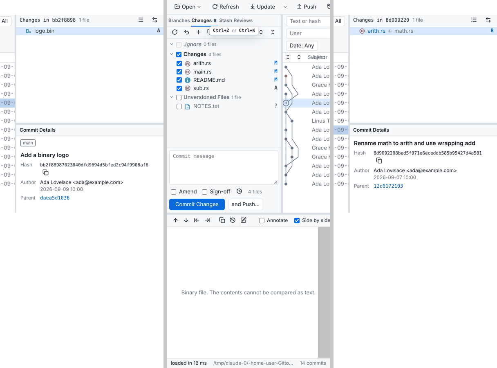
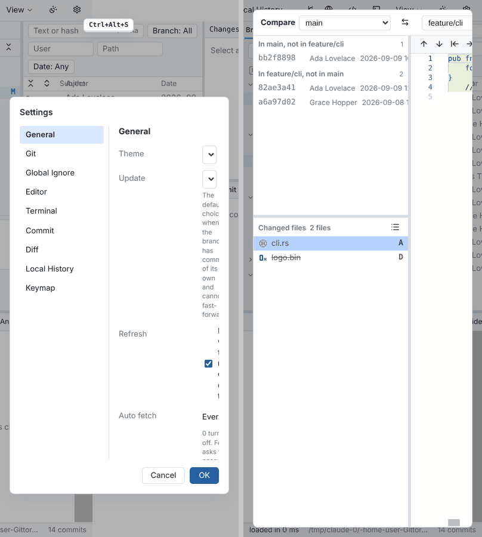
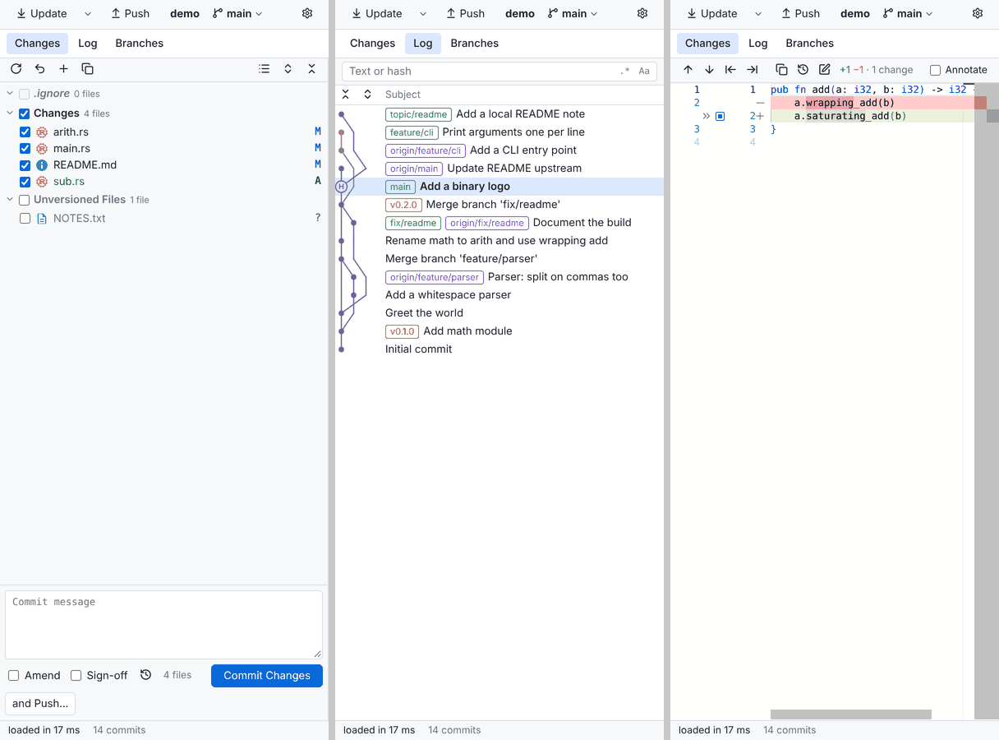
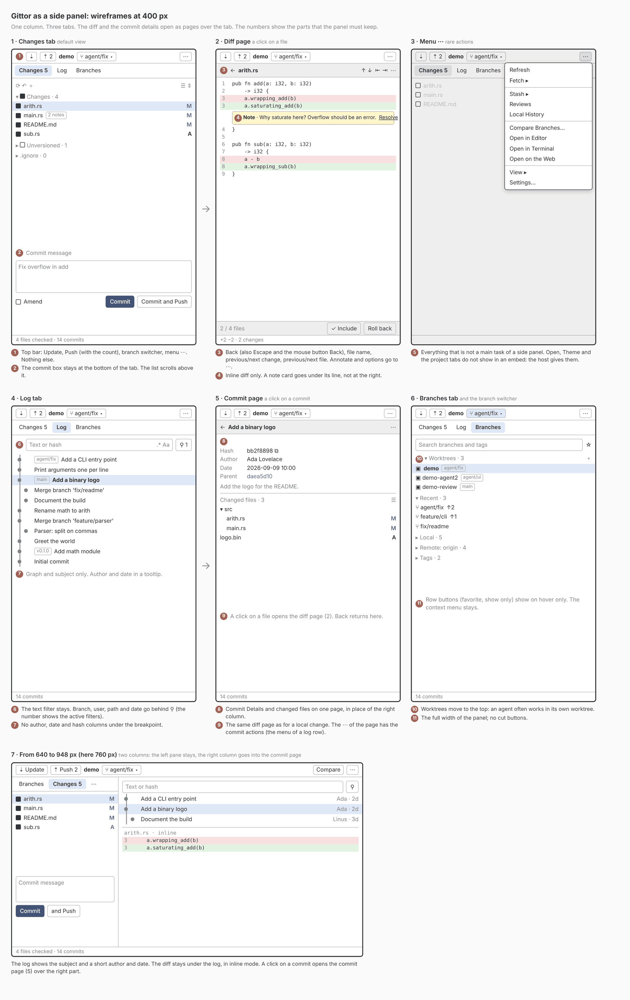

# A narrow layout for Gittor

This report is research only. It changes no layout code.

The owner wants to put Gittor into another app as a side panel, for example Orca (an editor for
coding agents). The panel is narrow: 320, 400 or 480 px wide, about 900 px high. The report answers
two questions:

1. Which parts must a narrow view keep, and which parts can it fold, hide or move to a menu?
2. What else does an embed need: loading, keyboard keys, theme, security?

## Method

- The UI and the dev server were built from `origin/main`. The demo repository came from
  `ui/e2e/make-demo-repo.sh`, with the local changes of `changelists.prep.sh`.
- A Playwright script opened the app at 320, 400, 480 and 1600 px wide and 900 px high. It took
  screenshots of the log, the Branches tab, the Changes tab, a local diff, a commit, the filter bar,
  the View menu, the Settings dialog, the branch menu and the Compare window. It also measured the
  `scrollWidth` of each region and listed the controls outside the viewport.
- A second script made a prototype with injected CSS only (no change in the repository): one
  column, tabs Changes / Log / Branches, and the diff over the whole panel.

## Result: the layout has a fixed minimum width of 948 px

`applyLayout` in `shell.ts` sets the columns of `.top` to
`sidebarWidth (280) + 4 + minmax(300px, 1fr) + 4 + rightWidth (360)`. The sum is 948 px. Below
948 px, the document scrolls horizontally (`scrollWidth` 948 at 320, 400 and 480 px). The browser
scrolls the page to the focused element, so each view shows a different slice of the layout:



*Today at 400 px. Left: after the start, the view shows Commit Details only. Middle: the Changes
tab, with the log and the commit details out of view. Right: a selected commit. The diff is cut on
all three.*

The toolbar needs 825 px. The diff panel spans the full width, but its side-by-side view and its
toolbar are cut. The status bar fits.

### What breaks, part by part

| Part | 320 px | 400 px | 480 px |
| --- | --- | --- | --- |
| Toolbar (Open, Refresh, Update, Fetch, Push, Local History, repository, branch, Remote, IDE, Terminal, View, Theme, Settings) | Needs 825 px. Only 3 buttons show; the others are out of view. | 4 buttons show. | 5 buttons show. |
| Project tabs | Scroll without a scroll bar (`tab-scroll-flow.ts`). They work, but show 1 or 2 tabs. | Same. | Same. |
| Left tabs Branches / Changes / Stash / Reviews | No label is cut (280 px column), but the column is often out of view. | Same. | Same. |
| Branches tree | Fits in its 280 px column. Favorite and "show only" buttons are out of view when the page scrolls. | Same. | Same. |
| Changes tab (changelists, commit message, Amend, Sign-off, Commit, and Push) | Fits in its 280 px column. | Same. | Same. |
| Log columns (graph, subject, author, date, hash) | The center column is 300 px. Graph + author 150 + date 125 + hash leave no room: the subject has width 0 and the header "Subject" overlaps "Author". | Same. | Same. |
| Filter bar (text, regex, case, branch, user, path, date) | Wraps to 3 rows in 300 px; branch, path and date are out of view. | Same. | Same. |
| Commit Details and changed files (right column, 360 px) | Wider than the viewport. Long hashes are cut. | Fits only when the page scrolls to it. | Same. |
| Diff panel | Full width, but the side-by-side view shows about 15 characters per side. The toolbar is cut after "Annotate". | About 25 characters per side. | About 35 characters per side. |
| Status bar | Fits; the path is cut with an ellipsis. | Same. | Same. |
| View menu, context menus | Fit (fixed position, `max-height: 70vh`). A long branch menu is cut at the right at 320 px. | Fit. | Fit. |
| Settings dialog | `min(820px, 100vw - 32px)` = 288 px. The section list takes about 140 px. The fields get one word per line. | Same, a bit better. | Readable but tight. |
| Compare window (and History, Review) | 288 px. Commits, file list and diff are side by side; the diff is about 60 px wide. | The diff is about 100 px wide. | The diff is about 180 px wide. |



*Today at 400 px: the Settings dialog (left) and the Compare window (right).*

No console error came during the run.

## Tasks in a side panel, and what they need

A side panel next to a coding agent has these main tasks. They are in order of frequency:

1. See the local changes of the agent. Needs: the Changes tab (changelists, file list, counts).
2. Read a diff of a local change. Needs: the diff panel, inline mode, next/previous change and file.
3. Commit, and Commit and Push. Needs: the commit message, the checkboxes, the two buttons.
4. Write and read review notes on local changes. Needs: the note layer in the diff, Copy All.
5. Switch the branch or the worktree. Needs: the branch button of the toolbar (branch switcher), the
   Worktrees group of the Branches tab.
6. Look at the recent history. Needs: the graph and the subject. Author, date and hash are optional.
7. Update and Push. Needs: two toolbar buttons.
8. Undo. Needs: the toast with Undo (it already fits: `max-width: min(460px, 100vw - 32px)`).

Rare tasks in a side panel: Compare Branches, Local History, Stash, Reviews of branches,
interactive history edits, Settings, remotes, open a repository.

## Recommendation, part by part

| Part | Recommendation | Reason |
| --- | --- | --- |
| Changes tab (changelists, commit box) | Keep. First tab and default view. | Tasks 1 and 3. |
| Diff of a local change | Keep, as a page over the whole panel, with a Back button. Force inline mode. | Task 2. Side by side gives fewer than 35 characters per side. |
| Review notes in the diff | Keep. Put the note cards under their lines (view zones), not at the right. | Task 4. A card at the right of a 400 px diff hides the code. |
| Branch button (switcher) | Keep in the top bar. | Task 5. |
| Update, Push | Keep as icon buttons in the top bar. | Task 7. |
| Log: graph and subject | Keep, in the Log tab. | Task 6. |
| Log: author, date, hash | Hide by default under the breakpoint. Show author and date as a second line or in a tooltip later. | The subject needs the width. |
| Filter bar | Fold: the text field only. The other filters go behind one filter button. | Text search is the main use. |
| Commit Details and changed files | Move under the log as a page: a click on a commit opens it (details at the top, files below, a click on a file opens the diff page). | It cannot be a third column. |
| Branches tab | Keep as the third tab. | Task 5 (worktrees), checkout. |
| Stash, Reviews tabs | Move to the overflow menu (or a fourth tab "More"). | Rare in a side panel. |
| Submodules section | Keep where it is (it hides when there are none). | Low cost. |
| Project tabs | Hide in an embed. The host gives the repository. | The host has its own tabs. |
| Open, Refresh, Fetch menu, Local History, Remote, IDE, Terminal, Theme | Move to one overflow menu ("⋯"). Theme and Open: hide in an embed. | Rare tasks; the host often has its own terminal and editor. |
| View, Settings | Move into the overflow menu. | Rare. |
| Status bar | Keep one line: the activity and the commit count. Hide the path. | The path is long and known. |
| Settings dialog | Full panel. Put the section list in a select at the top. | Fields need the width. |
| Compare, History, Review windows | Open as a full panel with steps (commits → files → diff), or in a separate window of the host. | Three columns cannot fit. |
| Merge window (conflicts) | Open as a full panel or a separate window. Three panes cannot fit at 480 px. | Rare, but it must work. |
| Context menus | Keep. Limit their width to the viewport. | They already work. |
| Toasts | Keep. | They already fit. |

## Layout ideas

### Idea A (recommended): one column with tabs, and pages that slide in

```
┌──────────────────────────────┐
│ ↓ ↑  repo  ⑂ main ▾       ⋯  │  top bar: Update, Push, branch switcher, overflow menu
├──────────────────────────────┤
│ Changes 5 │ Log │ Branches   │  three tabs
├──────────────────────────────┤
│                              │
│  the active tab              │
│  (Changes: list + commit box)│
│  (Log: filter text + graph)  │
│                              │
├──────────────────────────────┤
│ loaded in 17 ms · 14 commits │  status bar
└──────────────────────────────┘
```

- A click on a local change, or on a file of a commit, opens the diff page over the tab. The page
  has a Back button and the file name. Back, the Escape key and the mouse button Back close it
  (`nav.ts` already has a stack).
- A click on a commit in the Log tab opens a commit page: Commit Details and changed files.
- The CSS-only prototype shows that the existing panels fit at 400 px without other changes:



*Prototype at 400 px with injected CSS: the Changes tab, the Log tab (author, date and hash off),
and the diff page in inline mode. At 320 px, the diff toolbar is still cut after "1 change".*

### Wireframes of Idea A



*Wireframes at 400 px (frames 1 to 6) and at 760 px (frame 7). The source is
[`narrow-layout/wireframes.html`](narrow-layout/wireframes.html).*

1. **Changes tab** (the default view). The top bar holds Update, Push with its count, the
   repository, the branch switcher and the menu ⋯. The commit box stays at the bottom; the list
   scrolls above it. A file with review notes shows their count.
2. **Diff page** (a click on a file). The page bar holds Back, the file name, previous/next change
   and previous/next file. The diff is inline. A note card goes under its line. The bottom bar gives
   the position in the list and the actions of the file.
3. **Menu ⋯**. It holds all rare actions: Refresh, Fetch, Stash, Reviews, Local History, Compare
   Branches, Open in Editor/Terminal/on the Web, View and Settings.
4. **Log tab**. The text filter stays; the other filters go behind one button with a count. Only the
   graph and the subject show.
5. **Commit page** (a click on a commit). Commit Details and the changed files on one page. A click
   on a file opens the same diff page as in frame 2.
6. **Branches tab**. Worktrees come first, because an agent often works in its own worktree. The
   buttons of a row show on hover only.
7. **From 640 to 948 px**. Two columns: the left pane stays, and the log has the diff under it. The
   right column of today goes into the commit page.

### Idea B: two rows, no tabs for the main task

The Changes list at the top, the diff at the bottom (the current horizontal split of `diffRatio`).
The log and branches go into the overflow menu as pages. This keeps tasks 1 to 3 on one screen, but
at 900 px high each half gets only about 400 px. Idea A is better for reading a diff.

### Breakpoint

- Below **640 px**: Idea A (one column). 640 px covers side panels of 320 to 480 px with a margin.
- From 640 px to 948 px: a two-column variant. The left pane and the log stay; the right column
  (Commit Details, changed files) goes under the log, or into the commit page of Idea A. Today this
  range also scrolls horizontally.
- From 948 px: the current layout.

The breakpoint should follow the width of the window (a `ResizeObserver` or `matchMedia`), not a
setting. A side panel changes its width when the user drags it.

## Code that helps, and modules that a later change touches

Existing code that helps:

- `settings.showSidebar`, `settings.showDiff`, `toggleSidebar`, `toggleDiff` and `applyLayout`
  in `shell.ts`. The narrow mode can set the grid in `applyLayout` without a change of the saved
  settings.
- `showLeftTab` in `shell.ts` already switches the panels of the left pane. The narrow tabs can call
  it, plus a new "log" value.
- `settings.showAuthor`, `showDate`, `showHash` and the column code in `log-view.ts`
  (`col(...)`, `applyColumnWidths`). The prototype only set these three values.
- `settings.sideBySide` in the diff: inline mode works at 320 px.
- `nav.ts` (`visit`, `navigate`) for the Back button of a page.
- `menuBelow` in `context-menu.ts` for the overflow menu.
- The `.overlay` and `.history-window` styles: the windows are already in the page (fixed
  position), so they work in an iframe. They need a full-panel style only.
- The welcome screen and `?repo=` in the URL: the host can open a repository with a URL.

Modules that a later change touches:

| Module | Change |
| --- | --- |
| `shell.ts` | A `narrow` class on the root from a `ResizeObserver`; the grid in `applyLayout`; the new tab bar; the overflow menu. |
| `style.css` | Rules under `.narrow` (or `@media (max-width: 639px)`): one column, top bar, pages, full-panel dialogs and windows. Add them near the related rules, not at the end. |
| `log-view.ts` | Hide author, date and hash under the breakpoint without a change of the settings. |
| `filter-bar.ts` | Fold the filters behind one button. |
| `diff-view.ts`, `note-layer.ts` | Inline mode under the breakpoint; a Back button; note cards under the lines. |
| `details-panel.ts`, `changes-panel.ts` | Show as one commit page. |
| `windows.ts`, `compare-view.ts`, `history-view.ts`, `review-view.ts`, `merge-view.ts` | Full panel; one pane at a time. |
| `settings-dialog.ts` | Section list as a select. |
| `keyboard.ts` | Embed mode (see below). |
| `main.ts`, `tab-drag.ts`, `window-roots.ts` | Embed mode: no project tabs, no drag of a tab to a new window. |
| New `narrow-flow.ts` | The tab bar and the pages, as its own flow module (see "Work in parallel"). |
| `ui/e2e/narrow.mjs` | A new scenario at 400 px: commit, diff page, Back, branch switch. |

## What an embed needs beyond the width

### How the host can load Gittor

- **The dev server in an iframe or a web view.** `gittor-devserver ui/dist <port>` serves the UI and
  `POST /api/<command>`. The host loads `http://127.0.0.1:<port>/?repo=<path>`. This is the only way
  that puts Gittor inside the panel. The host starts and stops the server.
- **The Tauri app.** It is a separate native window. A host cannot put it into its own panel. It can
  only start it next to the host.
- Changes that the agent makes on disk show without Refresh: the `auto-refresh` scenario tests
  `watch.ts` with the dev server in a browser. Measure the delay with many changes of an agent.
- `openWindow` opens `window.open(...?solo=1)` when a tab is dragged out. In an embed, this makes a
  popup of the host. Turn it off.
- `api.openUrl` uses `window.open`. The host must let it open the system browser.

### Security of the dev server (important)

The dev server binds to 127.0.0.1 only, but it has no token and no check of the `Origin` header. The
UI sends `fetch` with a text body, which is a "simple request" without a CORS preflight. A test
showed that a request with `Origin: https://evil.example` runs a command (HTTP 200). So any web page
in any browser on the same computer can send write commands: commit, reset, push, or set the editor
command and then run it. Today this is acceptable for a test tool. Before an embed uses the dev
server, it needs:

- a random token that the host gives at the start (in the URL fragment or a header), and a check of
  it on each request;
- a refusal of requests with a foreign `Origin` or `Host` header (also against DNS rebinding);
- `Content-Type: application/json` on the requests, which forces a preflight.

### Keyboard keys

A key goes to the iframe when the iframe has the focus. Then the host does not get it, except for keys
that an Electron menu or the operating system takes first. These Gittor defaults can conflict with an
editor host:

| Key | Gittor | Usual in an editor host |
| --- | --- | --- |
| `Mod+1` … `Mod+5` | Left tabs, Submodules | Editor groups or tabs |
| `Mod+K` | Changes tab (also `Mod+2`) | Chord prefix (VS Code style), clear terminal |
| `Mod+W` | Close the project tab | Close the editor tab |
| `Mod+R` | Refresh | Reload the window |
| `Mod+F` | Filter the log | Find |
| `Mod+T` | Update | New tab, go to symbol |
| `Mod+O` | Open repository | Open file |
| `` Mod+` `` | Switch project | Toggle the terminal |
| `Mod+PageUp/PageDown` | Next/previous tab | Next/previous editor |
| `Mod+=`, `Mod+-`, `Mod+0` | Zoom | Zoom of the host |
| `Mod+Z` | Undo the last operation (not in a text field) | Undo |

Recommendation: an embed mode (`?embed=1`) that turns off the keys of project tabs, Open and zoom,
and that leaves only the keys of the active view. The keymap page already lets the user change the
keys (`settings.keymap`).

### Theme

`applyTheme` in `shell.ts` follows `prefers-color-scheme` when `theme` is "system". In an iframe this
is the setting of the operating system, not the theme of the host. The host should give the theme in
the URL (`?theme=dark`) or with `postMessage`, and the colors should come from CSS variables
(they already do: `--bg`, `--fg`, `--border`). A later step can take the background color of the host
so that the panel does not look like a separate window. `setMonacoTheme` must follow too.

### Other points

- The settings are in the storage of the web view (`localStorage`) and in `settings.json`. An iframe
  of `127.0.0.1:<port>` gets its own storage. A port that changes at each start loses the UI
  settings. Use a fixed port, or let the host give the settings.
- `settings.zoom` should start at 1 in an embed. The host has its own zoom.

## Open questions for the owner

1. Which host API does Orca give to a panel: an iframe with a URL, a web view, or only a process?
   This decides between the dev server and a new "embed server".
2. Must the narrow mode also work in the Tauri app when the user makes the window narrow, or only
   in an embed?
3. Is "Commit and Push" in one step the main way to commit in a panel, or must Push stay separate?
4. Do review notes on local changes stay in the panel, or does the agent read them through a file
   (`gittor/local-notes.json`) or through Copy All?
5. Should the host give the repository and the worktree (one panel for each worktree of the agent),
   or does the user switch the worktree in Gittor?
6. Is a token for the dev server acceptable, so that the host must pass it at the start?
