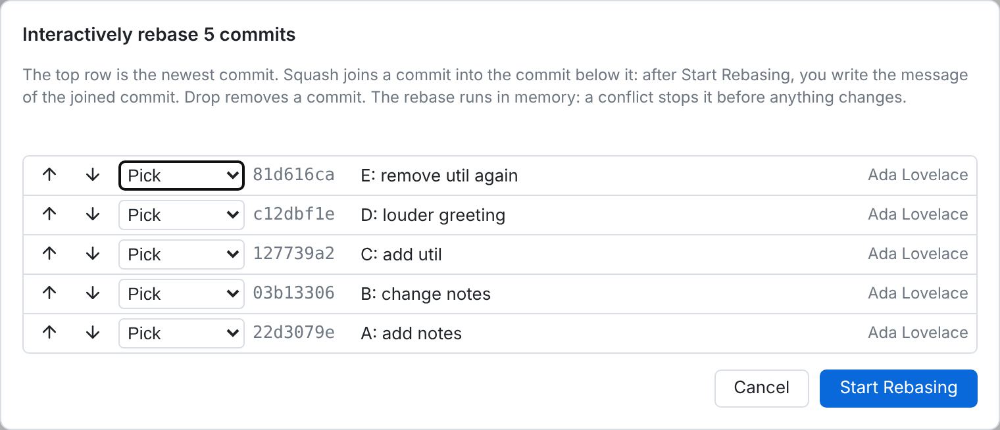
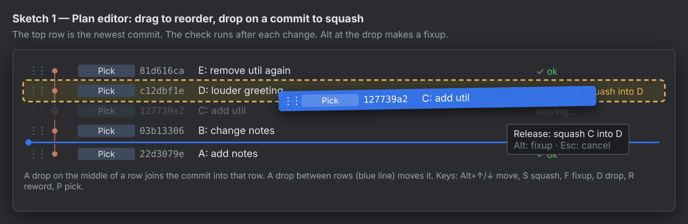
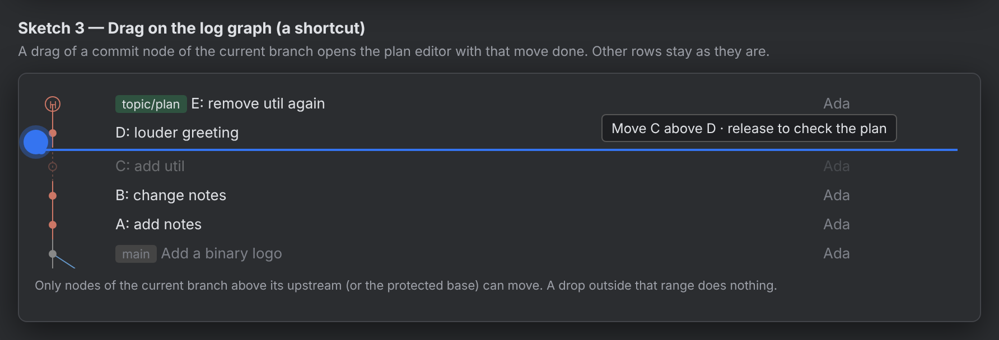
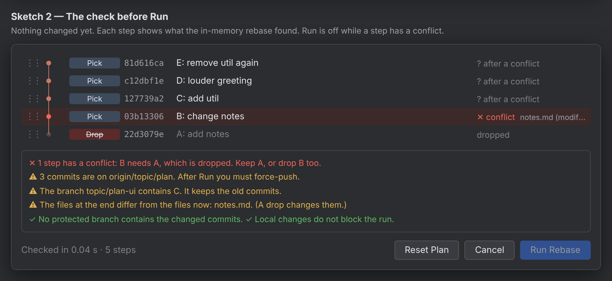
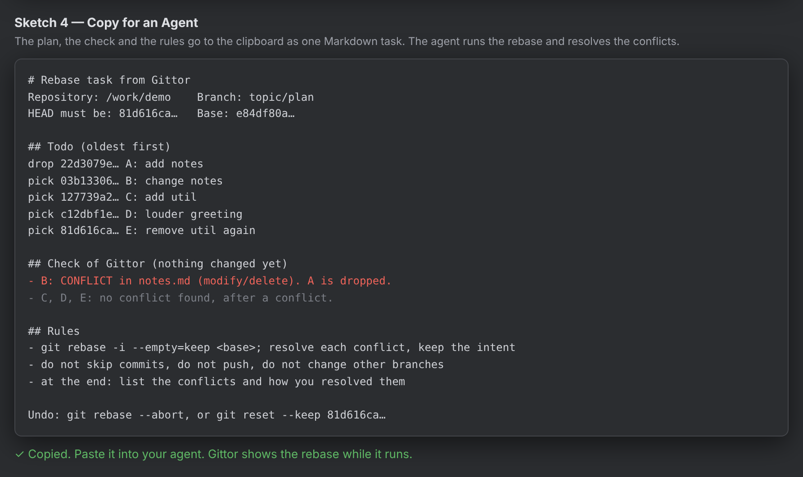

# Interactive rebase with drag and drop, and a check before the run

Status: research. No product code changed. This report recommends a design, the layers that it
touches, the tests that it needs, and the open questions.

## 1. Summary

- Gittor can do it. The in-memory rewrite of `crates/git/src/rewrite.rs` already replays a plan with
  `git merge-tree --write-tree` and `git commit-tree`. The same loop can run as a dry run: it then
  gives a result for each step and changes no ref, no index and no working tree.
- A prototype of the dry run (section 4) found the conflicting files, the commits that become empty,
  and a reorder that changes the final files. A plan of 500 commits took 1.9 s to 3.3 s.
- The recommended place for the drag is the Interactive Rebase dialog. It becomes a plan editor with
  a live check. A drag of a commit node in the log is a second entry point: it opens the same editor
  with that move done.
- No git client that we examined shows a conflict check of the whole plan before the run. Gittor can
  be the first.
- The owner decided the open points (section 10). New: "Copy for an Agent" copies the plan, the check
  and the rules, so a coding agent can run the rebase and resolve the conflicts (section 6.1).

## 2. What exists now



- `interactiveRebase` (`ui/src/operations.ts`) reads the range with `api.rewriteRange`, checks the
  protected branches (`allowRewrite`), opens `interactiveRebaseDialog` and runs the `rewrite` op.
- The dialog (`ui/src/dialogs.ts`) shows the newest commit at the top. Each row has Up and Down
  buttons and a select with Pick, Squash and Drop. It has no Fixup, Reword or Edit. A `fixup!` commit
  becomes a Squash, and its message stays out of the joined message. After Start Rebasing, a message
  dialog opens for each squash group.
- `Repo::rewrite` replays the plan in memory. Commits before the first change keep their hashes (the
  `unchanged` fast path). A conflict stops the rewrite before any ref changes, with the conflicting
  paths in the error. Then `update-ref`, or `reset --keep` when the tree of HEAD changes, moves the
  branch. Undo is one `Reset { mode: Keep }` step that checks that HEAD did not move.
- A plan with an Edit step runs a real `git rebase -i --autostash` (`rebase_interactive`).
- `rewrite_range` refuses a range with a merge commit, a detached HEAD and a running operation. An
  empty base means that the range starts at the root commit.
- "Published" is one boolean: `git branch -r --contains` of the oldest commit of the range.
- Protected branches (`ui/src/protected.ts`) are a UI check. `allowRewrite` looks only at the oldest
  commit of the range, also when the plan keeps that commit.
- The log (`ui/src/log-view.ts`) is virtual. Each row has a canvas for its graph cell
  (`paintRow` in `graph-paint.ts`) and DOM text. A render can replace a row element.
- The only custom drag is `dragTab` in `tab-drag.ts`: `mousemove` and `mouseup` on the document, a
  6 px threshold, and the new place from the middle of each element. AGENTS.md says: in WebKitGTK, call
  `preventDefault()` on `mousedown` for a custom drag, and test a drag in the real app.

## 3. Other git clients

Sources: web search summaries of the official pages. Some pages were not reachable from this machine;
"not confirmed" marks those details.

| Client | Where is the drag | Drop on a commit | Check before the run |
| --- | --- | --- | --- |
| IntelliJ IDEA | Dialog list (Move Up/Down; drag per a tutorial). The dialog shows a graph of the result. | Squash and Fixup are actions, not drops. | No. Since 2026 it rebuilds in memory first (`merge-tree`, `commit-tree`) and falls back to a real rebase on a conflict. |
| GitKraken | Drag a branch onto a branch, then a list editor with drag. | Not confirmed. | No. "Conflict Prevention" compares branches, not the plan. |
| Fork | Drag and drop in the active branch (2025). | Squash by drop (not confirmed in detail). | Not found. |
| Sublime Merge | No drag. Menu: move up/down, squash, drop. | No. | No. Undo from the reflog. |
| Tower | In the history (the log). | Squash; Alt makes a fixup. | No. Cmd+Z undo from the reflog. |
| GitButler | Drag by a handle in its branch lanes. | Squash, also across branches. | No. The rebase never stops; a commit keeps a "conflicted" state. |
| Lazygit | Keys only: Ctrl+J/K move, s squash, f fixup, d drop, r reword. | No. | No. |
| git-branchless, jj | Commands. | No. | git-branchless: an in-memory "speculative" apply that stops before any change. jj: records conflicts in commits. |

The two patterns: try in memory and stop or fall back (IntelliJ, git-branchless), or finish and keep
the conflicts in the commits (GitButler, jj). Tower's drop gestures are the clearest model for the
interaction: a drop between rows moves, a drop on a row squashes, Alt makes a fixup.

## 4. The dry run

### 4.1 The prototype

`dryrun.py` (in the scratchpad of the session, not in the repository) copies the loop of
`Repo::rewrite`. It does not move a ref. For each step it runs
`git merge-tree --write-tree -z --name-only --merge-base=<parent> <current> <commit>`, then
`git commit-tree` to get the next `<current>`. After a conflict it continues with the tree that has the
conflict markers, and marks the later steps "after a conflict".

The test branch `topic/plan` on the demo repository has five commits: A adds `notes.md`, B changes it,
C adds `util.rs`, D changes `main.rs`, E removes `util.rs`.

| Plan (oldest first) | Result of the dry run |
| --- | --- |
| A B C D E | All steps ok. The fast path keeps all hashes. |
| B A C D E | B: conflict, `notes.md` (modify/delete). A: conflict, `notes.md` (add/add). C, D, E: ok after a conflict. |
| A B C fixup(E) D | The C+E group is **empty**. The final tree is the same as before. |
| drop(A) B C D E | B: conflict, `notes.md` (modify/delete). |
| A B E C D | E is **empty** (it removes a file that is not there yet). No conflict. The final tree now has `util.rs`: **the reorder changed the result**. |

The last row is important. A reorder without a conflict can still change the files at the end. The
check must compare the final tree with the tree of HEAD.

The working tree, the index, the refs and the stash were the same after all runs. The dry run writes
only unreferenced objects (see 4.4).

### 4.2 What it gives for each step

- The new tree, and the new commit when the step is clean.
- The conflicting paths, and the kind of each conflict from the messages of `merge-tree`
  (content, add/add, modify/delete, rename/delete, binary).
- "Empty": the step has the tree of the commit before it. For a squash group, compare with the
  commit before the group.
- "After a conflict": the result of a later step is a guess, because the earlier tree has conflict
  markers.

For the whole plan it gives:

- The final tree, and the files that differ from HEAD (`git diff-tree --name-status HEAD <tree>`).
  A plan that only reorders and squashes must give the same tree. Else show a warning.
- The first changed step. Commits before it keep their hashes. The published, protected and other
  branch checks need only the commits from that step on.

### 4.3 Other checks of the plan (no replay needed)

| Check | How |
| --- | --- |
| Published commits | `git for-each-ref --contains <first changed> refs/remotes` gives the remote branches. For each of them, `git rev-list --count <remote>..HEAD` gives how many changed commits are not on it. Then the UI can say "3 commits are on origin/topic/plan". |
| Protected branches | The same list, matched to `settings.protectedBranches` in the UI. Use the first changed commit, not the oldest commit of the range. This removes false blocks. |
| Other local branches and tags | `git for-each-ref --contains <first changed> refs/heads refs/tags`, without the current branch. They keep the old commits after the run (git `--update-refs` moves them). |
| Local changes | `reset --keep` refuses when a dirty file differs between HEAD and the new tree. Intersect `git diff --name-only HEAD <new tree>` with the dirty files. Show the files before the run. |
| Squash at the bottom | The oldest kept commit cannot be a squash or fixup (the dialog checks this now). |
| Messages | A squash group without a message, an empty reword. |
| Signing | `commit.gpgsign` on: the run signs the new commits with the key of the user. Signatures of other people on rewritten commits go away. |
| HEAD moved | The check gives the HEAD oid. The run refuses when HEAD is not that oid any more. |

### 4.4 What the dry run cannot see

- Hooks. The in-memory run starts no hook (`pre-rebase`, `post-rewrite`, `pre-commit`). A real
  `git rebase -i` starts `pre-rebase` and `post-rewrite`. The run of Gittor is in memory too, so the
  check and the run agree.
- `exec` lines. The plan has no `exec`. A test command per step is out of scope.
- rerere. `merge-tree` does not use recorded resolutions. A conflict that rerere could solve shows as
  a conflict.
- The Edit action. It runs a real `git rebase -i`. The check is correct up to the first Edit step. After
  it, the user changes the files, so later results are a guess.
- Merge strategies and options (`-X ours`, `diff.renames` limits): the check uses the defaults of
  `merge-tree`, the same as the run.
- Objects. `commit-tree` and `merge-tree` write loose objects, which `git gc` removes later. To keep
  the repository clean, run the dry run with a temporary object directory
  (`GIT_OBJECT_DIRECTORY=<tmp>`, `GIT_ALTERNATE_OBJECT_DIRECTORIES=<repo objects>`) and delete it
  after the check.
- Signing. The dry run must not use `-S`: else gpg asks for the passphrase for each step. `commit_tree`
  needs a flag for that.

### 4.5 Cost

| Plan on a branch of 500 commits (200 files) | Git calls | Time |
| --- | --- | --- |
| Swap the two oldest commits (all 500 replayed) | 2001 | 3.3 s |
| Swap the two newest commits (498 on the fast path) | 1005 | 1.9 s |
| The 5 commits of the demo repository | 11–21 | 0.02–0.04 s |

Each replayed step costs about four processes (`show`, `merge-tree`, `commit-tree`, `show`). To make it
faster:

- Read the metadata of all commits with one `git log -z` call.
- Keep the results of the steps before the first changed step. A drag near the top replays few
  commits.
- Start the check 300 ms after the last change, and drop the result of an older check (a generation
  number, as `LogView` does).
- In a large repository, `merge-tree` cost grows with the number of changed paths, not with the size
  of the tree. The e2e scenario `large-repo.mjs` (`// e2e: large repository`) is the place to measure it.

### 4.6 Other ways, compared

| Way | Exact? | Side effects | Speed | Verdict |
| --- | --- | --- | --- | --- |
| In-memory `merge-tree` (as the run) | The same engine as the run, so the check equals the run. | None (objects only). | Fast. | **Recommended.** |
| Temporary worktree + real `git rebase -i` | Also hooks, rerere and exec. | Hooks run; a full checkout; disk. | Slow in a large repository. It stops at each conflict. | Only for an "exact" option later. |
| `git replay` | Same merge engine. | None. | Fast. | Not possible: Git 2.44+, experimental, and no reorder, squash or drop. This machine has Git 2.43. |
| `git rebase` with a temporary index | — | — | — | Not possible: a rebase needs a working tree. |

`merge-tree --write-tree` needs Git 2.38. Gittor needs it already.

## 5. The interaction

### 5.1 Where

Recommendation: **the dialog first, the log graph as a shortcut.**

- The dialog has room for the check result of each step, the messages and the Run button. Its list
  shows only the commits of the range, in one lane, so a drag is simple.
- The log is virtual, can hide commits (filters, collapsed branches), has many lanes and other
  branches, and draws rows again during a load. A drag there needs auto scroll and hit tests on the
  canvas. It is a good start point but a poor place for the result.
- The log shortcut: a drag of a node of the current branch, in the range that may be rewritten (above
  the upstream and the protected base), opens the plan editor with that move or squash done. The
  log does not change until Run.





### 5.2 Gestures

- A drag by the grip (or the row) with a 6 px threshold, as `dragTab`. Use mouse events, not HTML5
  drag and drop, and call `preventDefault()` on `mousedown` (WebKitGTK).
- A drop between two rows (the top and bottom quarter of a row) moves the commit. A blue line shows
  the place.
- A drop on the middle of a row joins the commit into that row: Squash. With Alt: Fixup. The target row
  gets a dashed frame and a hint "Release: squash C into D".
- A squash keeps the order rule of git: the joined commit goes right after its target. When the user
  drops C on an older commit A, the plan moves C to right after A, then sets Squash.
- A drag of a commit with squashed rows moves the whole group.
- Esc cancels a drag. Reset Plan gives the first plan back.
- Each row keeps a menu of actions: Pick, Reword, Edit, Squash, Fixup, Drop. Reword edits the message in
  place. The message of a squash group opens in the existing message dialog, at the row or at Run.
- Ghost nodes: the old place of a moving row shows dimmed with a dashed node. The small graph column
  of the dialog draws the new order; the nodes of dropped commits are hollow.

### 5.3 Keyboard

- Up and Down select a row. Alt+Up and Alt+Down move it (Lazygit uses Ctrl+J/K).
- P, R, E, S, F, D set Pick, Reword, Edit, Squash, Fixup, Drop.
- Enter runs when the check is clean. Esc closes.
- Register the keys in `keyboard.ts` as actions of the dialog, so the keymap page lists them and
  `ui/test/keymap-defaults.test.ts` finds duplicates.

## 6. The check screen



- Each row shows its result: ok, conflict (with the files and the kind), empty, dropped, or "after a
  conflict".
- A box under the list shows the warnings of the whole plan: published commits (force push), other
  branches and tags that keep old commits, protected branches (an error), local changes that block the
  run (an error), a different final tree (a warning, with the files).
- A click on a conflict row opens the three versions of the file (base, the new history, the commit)
  in the Compare window, read only.
- When the plan is clean, Run Rebase runs the in-memory rewrite.
- When a step has a conflict, the button is "Run and Stop at the Conflict" (decision of the owner).
  It runs a real `git rebase -i` with the plan as its todo list, as the Edit action does now. The
  rebase stops at the predicted step; the op banner and the Conflicts dialog then guide the user. An
  error of a check (protected branch, local changes that block the run) still turns the button off.
- "Copy for an Agent" copies the plan as a task for a coding agent (section 6.1).

Can the user resolve a predicted conflict before the run?

- Yes, technically. `merge-tree` without `--name-only` gives the stages (mode, oid, path) of each
  conflicting file. The merge window (`merge-view.ts`) can take these three blobs. The resolved file
  goes into the tree of the step through a temporary index, as `rewrite_files` does. The run then uses
  that tree for the step. This is the idea of jj and GitButler, but before the run.
- The resolution belongs to the inputs of the step (parent, the tree before, the commit). A change of
  the plan before that step makes it invalid. The UI must say so.
- The first version only shows the conflict, and offers "Run and Stop at the Conflict" and "Copy for
  an Agent". Resolution ahead of time can come later.

### 6.1 Copy for an Agent

The owner wants a way to give the plan to an agent (for example Claude Code in a terminal). The agent
runs the rebase and resolves the conflicts at the same time.

- A button "Copy for an Agent" in the plan editor copies one Markdown text to the clipboard. It works
  for a clean plan and for a plan with conflicts. A plan with conflicts is the main case.
- The text has these parts:
  1. The repository path, the branch, the full oid of HEAD and of the base. The agent stops when HEAD
     is not that oid.
  2. The todo list of `git rebase -i`, oldest first, with full oids and subjects. A reword or a squash
     group gets its message in a block, and an `exec git commit --amend -F <file>` line, as
     `rebase_interactive` writes now. An Edit step says what the user wants changed, if the user wrote
     a note.
  3. The result of the check for each step: the predicted conflicts with their files and kinds, the
     empty steps, and the steps "after a conflict".
  4. The rules: keep empty commits (`--empty=keep`); do not skip or drop a commit; resolve each conflict
     so that the commit keeps its intent on the new history; `git add` and `git rebase --continue`;
     do not push; do not change other branches.
  5. The end: a list of the conflicts and how the agent resolved them, then `git log --oneline` of the
     range.
  6. Undo: `git reset --keep <old HEAD>`, or `git rebase --abort` while the rebase runs.
- Gittor shows the work of the agent by itself: the watcher sees the rebase, the op banner shows it,
  and the log loads again when it ends.
- Gittor keeps the old HEAD of a copied plan. When the branch moves away from it after a rebase, a
  toast offers Undo (a `Reset { mode: Keep }` step with the new HEAD as `expected_head`).
- The text is made by a pure function `rebase-agent-text.ts`, as `note-format.ts` makes the text of
  review notes. It has unit tests.

Example for the demo plan "drop A, then B C D E":

````markdown
# Rebase task from Gittor

Repository: /work/demo
Branch: topic/plan
HEAD must be: 81d616ca… (full oid). Stop if it is not.
Base: e84df80a… (full oid)

## Todo (oldest first)

```
drop 22d3079e… A: add notes
pick 03b13306… B: change notes
pick 127739a2… C: add util
pick c12dbf1e… D: louder greeting
pick 81d616ca… E: remove util again
```

## Check of Gittor (nothing changed yet)

- pick 03b13306 "B: change notes": CONFLICT in notes.md (modify/delete). B changes notes.md, which A
  added. A is dropped.
- C, D, E: no conflict found, but they come after a conflict.

## Rules

- Run: write the todo to a file, then
  `GIT_SEQUENCE_EDITOR="cp <todo file>" git rebase -i --empty=keep <base>`.
- At each conflict, resolve it so that the commit keeps its intent on the new history. Then
  `git add` the files and `git rebase --continue`. Do not skip or drop a commit.
- Do not push. Do not change other branches.
- At the end, list each conflict and how you resolved it, then show `git log --oneline <base>..HEAD`.

Undo: `git rebase --abort` during the rebase, or `git reset --keep 81d616ca…` after it.
````



## 7. Risks and limits

- Merge commits in the range: `rewrite_range` refuses them. Keep this. A drag in the log onto or across
  a merge must do nothing, with a hint.
- A range across a merge: the same refusal. A graph drag offers only the commits of the first-parent
  chain above the last merge.
- Root commit: the dry run handles an empty base like `rewrite` (an empty commit as `onto`). A drag that
  puts a squash at the bottom is an error of the plan.
- Signed commits: the run signs with the key of the user; signatures of others go away. The dry run
  must not sign.
- Local changes: `reset --keep` can refuse at the end. The check predicts this. The Edit path uses
  `--autostash`.
- A long branch: up to a few seconds per check. Debounce, keep the unchanged prefix, show a spinner, and
  allow Run only for the current result.
- A change of the repository between the check and the run (a commit in a terminal, the watcher):
  the run must refuse when HEAD moved, and the dialog checks again on `onRepoChange`.
- Empty commits: Gittor keeps them (decision of the owner). `rewrite` keeps them now. The real
  `git rebase -i` path (Edit, Run and Stop at the Conflict, the agent text) must use `--empty=keep`, so
  all paths agree. The check shows them, so the user can drop them by hand.
- An agent works outside Gittor: it can push, change other branches or resolve badly. The text forbids
  this, and Undo of the old HEAD stays possible. The reflog keeps the old commits too.
- Drag in WebKitGTK and WKWebView: test in the real app (Xvfb and xdotool on Linux; the owner on a Mac).

## 8. Layers that the change touches

1. `crates/git/src/rewrite.rs`
   - Move the loop of `rewrite` into one function `replay(base, plan, mode)`. `mode` is Run or Check.
     The run and the check then use the same code, so the check cannot differ from the run.
   - `Repo::rewrite_check(base, plan) -> RewriteCheck`: the steps (oid, status, files, kinds, tree),
     the first changed step, the final tree and its changed files, the remote branches, other refs and
     dirty files that touch the result, and the HEAD oid. No `-S`, a temporary object directory.
   - Optional `Action::Fixup` without a message in the UI (the backend has it).
   - `rewrite` takes an optional `expected_head` and refuses when HEAD moved.
2. `crates/service`: a query `rewrite_check` in `queries.rs` and one line in `dispatch.rs`. The `Rewrite`
   variant of `Op` gets `expected_head`. The real
   rebase path gets `--empty=keep` and a mode that stops at the first conflict.
3. Types: `RewriteCheck`, `StepCheck`, `StepStatus` with `#[derive(ts_rs::TS)]`; run
   `export_bindings`. Add `rewriteCheck` to `api.ts` and the new field to the `Op` union.
4. UI
   - `rebase-plan.ts`: a pure model of the plan (move, move a group, squash into, fixup into, drop,
     validate, the order rule of squash). Unit tests in `ui/test/rebase-plan.test.ts`.
   - `rebase-drag.ts`: the custom drag of rows, after `tab-drag.ts`.
   - `rebase-flow.ts`: the editor, the debounced check, the check box, Run. It replaces
     `interactiveRebaseDialog`; `interactiveRebase` in `operations.ts` calls it.
   - `rebase-agent-text.ts`: the text of Copy for an Agent. Unit tests in
     `ui/test/rebase-agent-text.test.ts`.
   - The action menu of a row gets Reword and Edit (decision of the owner). Reword edits the message in
     place; Edit runs the real rebase that stops at the commit.
   - `log-view.ts`: an `onNodeDrag` callback from the graph canvas for the shortcut.
   - `protected.ts`: check the first changed commit.
   - `keyboard.ts`, `style.css`: the new actions and classes, at their places in order.

## 9. Tests

Rust (`crates/git/tests/rewrite_check.rs`):

- A reorder that conflicts gives the step and the paths. A drop of a needed commit gives a conflict.
- A squash or a reorder that makes a step empty gives "empty".
- A reorder that changes the final tree gives the changed files.
- The check changes no ref, no index, no working tree and no stash (compare `for-each-ref`,
  `git status --porcelain=v2` and the index file before and after), and leaves no new loose object.
- The check equals the run: for many plans on a small repository (all orders of four commits, with
  drops and squashes), "clean" in the check means `rewrite` succeeds, and the trees are the same.
- A range from the root commit. A range with a merge is refused.
- Other branches and tags that contain changed commits. Dirty files that block `reset --keep`.
- With `commit.gpgsign`, the check does not sign (in `signing.rs`, which has gpg).
- `rewrite` with an old `expected_head` refuses.

UI unit tests: `rebase-plan.test.ts` for the model, `rebase-agent-text.test.ts` for the text (full
oids, oldest first, messages of squash groups, the conflicts, the Undo line).

More Rust tests: Run and Stop at the Conflict stops at the predicted step with the predicted files;
empty commits stay on both paths.

e2e scenarios (one file each):

- `rebase-drag.mjs`: open Interactively Rebase, drag a row up, drop a row on another (squash), Alt drop
  (fixup), see the check of each row, make a conflict and see its files, fix the plan, Run, then Undo.
- `rebase-graph-drag.mjs`: drag a node in the log; the editor opens with the move; a drop on a merge
  or on a protected commit does nothing.
- Keyboard: Alt+Up/Down and the action letters.
- `rebase-agent.mjs`: Copy for an Agent puts the text on the clipboard (read it with
  `navigator.clipboard` in Chromium). The scenario then runs the todo of the text with a script in
  place of the agent, as the scenarios of Open in Editor do, and checks that the log shows the result
  and that Undo brings the old HEAD back.
- Run and Stop at the Conflict: the op banner shows the rebase at the predicted commit.
- Add the check to the large repository scenario, or measure it there, before a release.

## 10. Decisions of the owner

1. The plan editor in the dialog comes first. The drag in the log is a shortcut to it.
2. The first version has "Run and Stop at the Conflict" (a real rebase that stops at the conflict).
3. Empty commits stay.
4. Other local branches that contain rewritten commits do not move.
5. A drop on a commit is a Squash; with Alt it is a Fixup.
6. The action menu gets Reword and Edit.
7. Left to the designer. Decision: the main log shows no preview. The small graph in the dialog shows
   the new order, with ghost nodes. The main log shows the result after the run. A preview in the main
   log would mix two states in one view, and the log is virtual and filtered.
8. New: "Copy for an Agent" copies the plan, the check and the rules for a coding agent, which runs the
   rebase and resolves the conflicts (section 6.1).

## 11. More decisions of the owner

1. The agent text goes to the clipboard only. Gittor writes no file for it.
2. Gittor does not start the agent. It only copies the text.
3. Undo after the work of an agent is a toast. Gittor keeps the old HEAD of the copied plan. When the
   rebase ends and the branch is not at that HEAD, a toast with Undo shows (section 6.1).

No question is open now.
